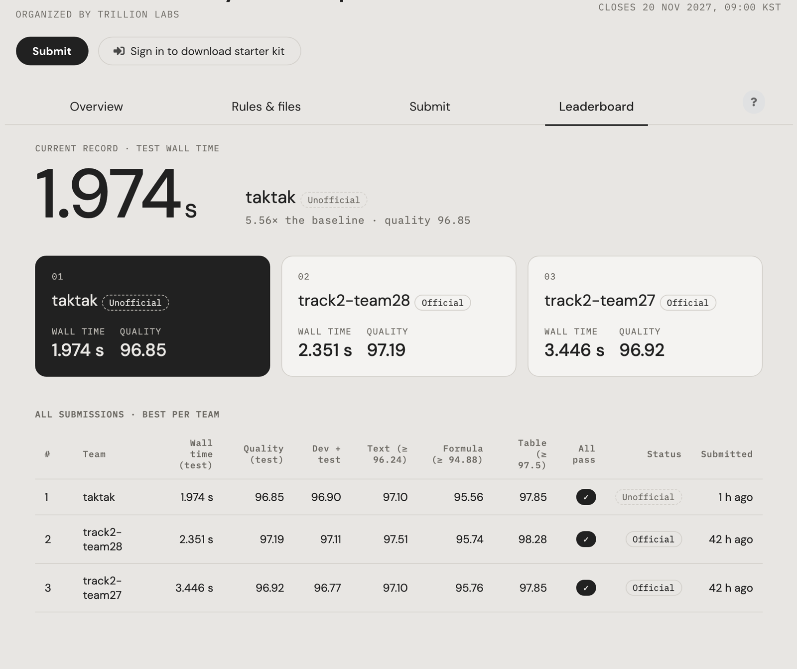

# Gravity OCR Speed Run — 1.974 s (team taktak)



Trillion Labs 해커톤 Track 2 "Gravity OCR Speed Run" 제출본과 그 과정입니다.
GravityOCR-KO로 크롭 402장(텍스트 210, 표 62, 수식 130)을 L40S 한 장에서 읽는 시간을 품질 합격선 안에서 줄이는 대회입니다.

최종 2.979s로 베이스라인 10.981s 대비 3.68배 가속하여 리더보드 2등을 기록하였습니다.

대회 이후, 개인적으로 개선하여 1.974s로 베이스라인 대비 5.56배 가속하여 SOTA에 도달하였습니다. 

| | 리더보드 시간 | 품질 | 가속 |
|---|---:|---:|---:|
| 기준 모델 (대회 베이스라인) | 10.981 s | 97.21 | 1.00× |
| 318 `ty_m3d` | 2.282 s | 96.97 | 4.81× |
| **319 `ty_m4_lanes_c4`** | **1.974 s** | **96.85** | **5.56×** |

품질 합격선: 텍스트 ≥ 96.24, 수식 ≥ 94.88, 표 ≥ 97.50 (기준 모델 점수 − 1점).

## 추론 가속 방식

GravityOCR의 추론 파이프라인은 이미지 전처리 → ViT(이미지 인코더) → 언어 모델의 self-speculative 디코딩(블록 확산 초안 +
검증) 순서로 흐릅니다. 단계마다 아래 방법을 적용했고, 모두 `submission/TY_SETTINGS`의 스위치로 켜고 끕니다.

### 1. 과제별 서버 분할 (CUDA MPS)

표와 텍스트·수식은 디코딩 성질이 다릅니다. 표는 초안이 거의 다 맞아 초안 길이가 길수록 라운드가 줄고, 텍스트·수식은 라운드당
8~13토큰만 맞아 긴 초안이 계산 낭비가 됩니다. 한 GPU에 SGLang 서버를 두 개 띄워(CUDA MPS) 표 서버는 초안 33·낮은 MPS
우선순위, 텍스트·수식 서버는 초안 13으로 돌립니다. 가장 긴 표의 라운드 수와 텍스트 쪽 라운드 계산량이 함께 줄어듭니다.
`TRACK2_LANES=table;text,formula`, `TRACK2_LANE_DRAFT=33,13`, `TRACK2_LANE_MPS_PRIO=1,0` 외

### 2. 초안 학습 언어 모델 가중치

self-speculative 디코딩의 초안 적중률을 높이도록 학습한 언어 모델 가중치(이전 278번 제출)를 씁니다. 제출본에는 기본 가중치와
다른 텐서 118개만 담고(1.35 GB), 서버 시작 전(측정 밖)에 전체 가중치로 합칩니다. `weights_delta/`

### 3. 글자 크기 기반 해상도 조정

크롭마다 글자 본체 높이를 재서 텍스트·표는 11 px, 수식은 14 px가 되도록 줄여 ViT 패치 수를 줄입니다. 축소 대상은 패치
256개 이상인 크롭입니다. `TRACK2_TEXT_GLYPH=11`, `TRACK2_TABLE_GLYPH=11`, `TRACK2_FORMULA_GLYPH=14`, `TRACK2_GLYPH_MIN_PATCHES=256`

### 4. 빈 영역 ViT 건너뛰기 (호스트 동기화 없음)

2×2 병합 묶음 네 패치가 모두 단색이면 ViT 24블록을 건너뛰고 같은 이미지의 앞쪽 빈 묶음 출력을 복사합니다(8개 중 1개는 계산).
빈 영역 판정은 한 배치 앞서 별도 스트림에서 계산해 호스트로 비동기 복사하므로, ViT 실행 중에 스케줄러가 기다리지 않습니다.
표는 빈 셀·얇은 선 때문에 품질이 떨어져 제외합니다. `SS_VIT_DROP=1`, `SS_VIT_DROP_TABLE=0`

### 5. ViT MLP 융합 커널

ViT MLP의 gate_up 행렬곱(FP8, FP16 누적)과 SiLU·곱을 Triton 커널 하나로 합쳐, 중간 결과 [M, 8192] bf16을 메모리에 쓰고
다시 읽는 과정을 없앴습니다. 가장 흔한 1.6만 패치 배치에서 1.19배 빠르고 결과는 비트 단위로 같습니다. `SS_FUSED_SILU_VIT=1`

### 측정 (RunPod L40S, dev 402장, 새 프로세스 3회 중앙값)

| 방법 | 단독 효과 |
|---|---|
| 2. 초안 학습 가중치 | 2.35 → 2.29 s |
| 3. 글자 크기 11 px (텍스트·표) | 2.29 → 2.21 s |
| 3. 수식 14 px | 2.18 → 2.15 s |
| 3. 축소 대상 패치 256개 이상 | 2.18 → 2.14 s |
| 4. 빈 영역 ViT 건너뛰기 | 2.18 → 2.15 s |
| 5. ViT MLP 융합 커널 | 2.18 → 2.16 s |
| 3~5 함께 (서버 1대) | 2.18 → 2.06 s |
| **1. 과제별 서버 분할 추가** | **2.06 → 1.91 s** |

최종 구성을 제출 zip 그대로 돌린 결과:

| | 3회 시간 | dev 텍스트 / 수식 / 표 | 홀드아웃 100장 텍스트 / 수식 / 표 |
|---|---|---|---|
| `ty_m4_lanes_c4` | 1.94 / 1.89 / 1.92 s (중앙값 1.92 s) | 96.91 / 95.19 / 98.63 | 96.79 / 96.16 / 99.85 |

시간 분석과 효과가 없던 시도는 [docs/ANALYSIS.md](docs/ANALYSIS.md)에 정리했습니다.

## 디렉터리 구조

```
submission/   제출 zip의 내용 (가중치 제외). team.yaml -> ty_launch.py -> TY_SETTINGS를 읽고 serve.py 실행
patches/      서빙 코드에 위 방법들을 넣는 스크립트 (모두 기본 꺼짐), 제출 zip 만들기, 융합 커널과 벤치
tools/        측정 도구: 대회 하네스와 같은 방식의 dev 측정(dev_harness.py), 도커/네이티브 실행, 공식 채점, 홀드아웃 채점
tools/profiling/  nsys 프로파일(시간 측정 구간만), 커널 시간 분해, 요청별 타임라인과 라운드 수 분석
results/      각 실험의 설정과 시간(timing.json), 품질(scores.json) 요약
docs/         분석 문서, 리더보드 화면
```

## 재현 방법

1. 대회 이미지 `track2-base:v1`(스타터 키트의 `track2-base/Dockerfile`)이 있는 L40S(드라이버 570)를 준비합니다.
   `submission/`에는 빌드된 네이티브 라이브러리(`gravity_ocr/_native/*.so`)와 SGLang overlay가 들어 있습니다.
2. `patches/pack_minion_submission.sh <이름> patches/TY_SETTINGS`로 서빙 폴더에 패치를 넣고 제출 zip을 만듭니다.
3. 측정: `TEAM=<팀 폴더> REPS=3 bash tools/devrun.sh <이름>` (시간), `bash tools/score.sh <이름>` (공식 채점).

가중치는 이 저장소에 없습니다(`submission/weights_delta/README.md`). 가중치 파일이 없으면 서버는 이미지의 기본
GravityOCR-KO 가중치로 그대로 돌아갑니다(측정상 약 3% 느림).

## 라이선스

Track 2 1위 팀의 공개 저장소 [sungu-che/minion](https://github.com/sungu-che/minion)을 참고했고, 그 서빙 기반 코드(SGLang
self-speculative 서빙, FP8 커널, 전처리)를 Apache License 2.0에 따라 사용했습니다. 출처와 변경 내역은
[NOTICE.md](submission/NOTICE.md)에 있습니다. 이 저장소도 Apache License 2.0을 따릅니다([LICENSE](LICENSE)).
